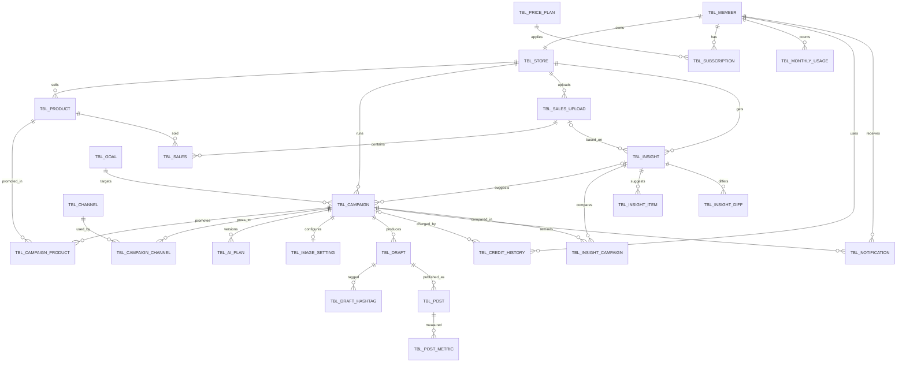

# BizGent DB 설계 점검 (DB 연동 전 ERD 확정용)

- 작성일: 2026-11-08
- 비교 기준: `04_DB설계/사계절_ERD_물리.pdf` (BizGent_ERD_20261012)
- 코드 기준: `main` 브랜치 + 커밋 전 작업분(회원가입 이름·연락처·업종, 캠페인 이어서 작성하기)
- 범위: 분석만. 코드·ERD 문서는 수정하지 않았다.
- 2026-11-08 갱신: 팀 결정 사항을 반영한 **최신 ERD 수정안은 [7장](#7-결정-사항-반영-2026-11-08)**에 있다. 1~6장·부록은 처음 점검한 기록으로 남겨 둔다.

> **전제** — 프로젝트에는 SQL 스키마, 마이그레이션, MyBatis 매퍼, JPA 엔티티가 없다. 모든 데이터는 `demo/DemoSession`(@SessionScope)에 들어 있고 `DemoSeed`가 시연 데이터를 채운다. 아래 "코드 모델"은 `domain/` 클래스와 그 클래스를 실제로 읽고 쓰는 service·controller·템플릿을 근거로 정리했다.

표기: V = VARCHAR2, N = NUMBER, C = CHAR, D = DATE, NN = NOT NULL, ✅ 있음 / ❌ 없음 / △ 일부

---

## 1. 코드가 실제로 저장·조회하는 데이터

### 1-1. DemoSession이 들고 있는 것

| DemoSession 필드 | 의미 | DB로 갈 곳 |
|---|---|---|
| `member` | 로그인한 회원 1명 | MEMBERS (+ SUBSCRIPTION, CREDIT_HISTORY) |
| `store` (+ `store.products`) | 회원의 매장 1개와 메뉴 목록 | STORE, PRODUCT |
| `campaigns` | 캠페인 목록 (작성 중 + 게시 완료) | CAMPAIGN 외 6개 테이블 |
| `sales`, `salesUploads` | 매출 행, 업로드 이력 | SALES, SALES_UPLOAD |
| `notifications` | 성과 입력 알림 | NOTIFICATION |
| `termsAgreed`, `termsAgreedAt` | **로그인 전** 약관 동의 (가입 시 Member로 옮겨짐) | HTTP 세션 유지 (DB 아님) |
| `loggedIn`, `startIntent` | 로그인 여부, 로그인 후 이동할 곳 | HTTP 세션 유지 |
| `activeDraftId` | 지금 위자드에서 편집 중인 캠페인 ID | HTTP 세션 유지 (DB 아님) |
| `insightsView` | 개발 바로가기: 개선 방향 데이터 양 | DB 아님 (개발용) |
| `sequence` (AtomicLong) | 모든 ID를 하나의 번호로 발급 | 테이블별 시퀀스로 대체 |

### 1-2. 엔티티별 컬럼 (코드 기준)

타입은 Java 타입을 Oracle 타입으로 옮긴 제안값이다. "필수"는 코드가 null을 허용하지 않거나 항상 값을 넣는 경우다.

**Member → MEMBERS**

| 필드 | 제안 타입 | 필수 | 비고 |
|---|---|---|---|
| memberId | N(10) | PK | |
| email | V(100) | 필수, UK | 가입 시 중복 검사 |
| password | V(255) | 필수 | 모의 인증이라 현재 저장 안 함 → DB 단계에서 해시 저장 |
| memberName | V(50) | 필수 | 회원가입 추가 (2~20자 검증) |
| phone | V(20) | 선택 | 회원가입 추가, `010-0000-0000` 형식 |
| termsAgreed | C(1) | 필수 | 가입 시 true만 저장 가능 |
| termsAgreedAt | D | 필수(가입 시) | 회원가입 추가 |
| plan | V(20) | 필수 | FREE / PRO → SUBSCRIPTION으로 분리 대상 |
| credits | N(10) | — | **DemoSeed만 값을 넣고 화면·로직 어디서도 읽지 않음** |
| campaignsUsedThisMonth | N(5) | 필수 | 캠페인 시작 시 +1 (무료만) |
| usageResetAt | D | — | 화면에 "다음 리셋일"로 **표시만** 함. 실제 초기화 로직 없음 |
| monthlyCampaignLimit | N(5) | 필수 | 기본 3 → PRICE_PLAN 값 |

**Store → STORE** (회원과 1:1)

| 필드 | 제안 타입 | 필수 | 비고 |
|---|---|---|---|
| storeId | N(10) | PK | |
| storeName | V(100) | 필수 | 회원가입에서 입력 |
| category | V(50) | 필수 | 회원가입에서 입력 (`StoreController.CATEGORIES`) |
| description | V(1000) | 선택 | |
| phone | V(20) | 선택 | 매장 정보 화면의 매장 연락처 |
| address | V(200) | 선택 | |
| targetCustomer, toneManner | V(500) | 선택 | 칩 여러 개를 쉼표로 이은 문자열 |
| targetDescription, toneDescription | V(1000) | 선택 | |
| heroImageUrl | V(500) | 선택 | |
| brandColor | C(7) | 선택 | `#RRGGBB` |
| products | — | — | 1:N PRODUCT |

**Product → PRODUCT**: productId PK, productName V(100) 필수, price N(10) 필수, stockQty N(10) 선택, description V(1000) 선택, imageUrl V(500) 선택

**Campaign → CAMPAIGN** (+ 하위 객체)

| 필드 | 제안 타입 | 필수 | 비고 |
|---|---|---|---|
| campaignId | N(10) | PK | |
| title | V(200) | 필수 | 이름 변경 가능 |
| status | V(20) | 필수 | DRAFT(작성 중) / PUBLISHED |
| createdAt, updatedAt | D | 필수 | |
| publishedAt | D | 선택 | |
| reminderAt | D | 선택 | "7일 뒤 알림" → NOTIFICATION.DUE_AT과 중복 |
| goal | V(200) | 1단계 전 null | 화면 표시용 최종 목표 문구 |
| goalOption | V(50) | 1단계 전 null | `GOAL_OPTIONS` 중 하나 |
| customGoal | V(200) | 선택 | goalOption이 "기타 (직접 입력)"일 때 |
| productIds | List<Long> | 선택 | **여러 개** → N:M |
| targetCustomers, toneManners | V(500) | 선택 | 1단계 칩 |
| extraNote | V(300) | 선택 | 1단계 추가 요청 |
| thumbnailUrl | V(500) | — | 시안 이미지에서 계산 가능 |
| insightPrefill | C(1) | — | 개선 방향에서 시작했는지 |
| lockedStep | V(10) | 선택 | 확정해서 되돌아갈 수 없는 단계 |
| currentStep | V(10) | 선택 | 마지막으로 보던 단계 (이어서 작성하기) |
| selectedDraftKeys | List<String> | 선택 | 4단계에서 고른 A/B |

- `plan` (AiPlan, 1:1): direction, targetCustomer, strategy, expectedEffect, userRequest, ageGroup, channels(목록), tones(목록), reach, frequency, duration
- `content` (ContentSetting, 1:1): channels(목록), hashtagOn, imageOn, captionOn, customChannelName, customChannelNote
- `image` (ImageSetting, 1:1): mood, composition, referenceImageUrl, purpose, product, brandColorOn, ratios(채널→비율 Map), extraRequest
- `drafts` (Draft, 1:N): key(A/B), channel, text, hashtags(목록), imageUrl — **자체 ID 없음**
- `posts` (Post, 1:N): channel, draftKey, status, views, clicks, conversions — **자체 ID 없음**

**Sale → SALES**: salesId PK, saleDate D 필수, productId FK 필수, quantity N(6), amount N(12), source V(20) (excel/receipt/manual) — **업로드 이력과 연결 필드 없음**

**SalesUpload → SALES_UPLOAD**: uploadId PK, uploadedAt D, inputType V(20), rowCount N(6)

**Notification → NOTIFICATION**: notificationId PK, campaignId FK, message V(500), dueAt D 선택, read C(1)

**저장하지 않는 것**: 개선 방향 결과(`AiService.Insights`)는 화면을 열 때마다 새로 계산한다. 목표·채널·업종 목록은 Java 상수다.

### 1-3. 관계 (코드 기준)

| 관계 | 종류 | 근거 |
|---|---|---|
| 회원 – 매장 | 1:1 | DemoSession에 `member`, `store` 하나씩 |
| 매장 – 메뉴 | 1:N | `Store.products` |
| 매장 – 캠페인 | 1:N | `session.campaigns` |
| 캠페인 – 메뉴 | **N:M** | `Campaign.productIds` (1단계 복수 선택) |
| 캠페인 – 채널 | N:M | `ContentSetting.channels` |
| 캠페인 – 기획 / 콘텐츠 설정 / 이미지 설정 | 1:1 | 객체 하나씩 |
| 캠페인 – 시안 | 1:N (A/B × 채널) | `Campaign.drafts` |
| 시안 – 해시태그 | 1:N | `Draft.hashtags` |
| 시안 – 게시 | 1:N | `Post.draftKey` + `channel` |
| 캠페인 – 알림 | 1:N | `Notification.campaignId` |
| 메뉴 – 매출 | 1:N | `Sale.productId` |
| 업로드 – 매출 | **연결 없음** | `Sale.source`만 있음 |

---

## 2. ERD와 비교

### 2-1. 코드에는 있는데 ERD에 없는 것

| 테이블 | 코드 필드 | 제안 컬럼 | 비고 |
|---|---|---|---|
| (신규) | `Campaign.productIds` | **CAMPAIGN_PRODUCT** (CAMPAIGN_ID, PRODUCT_ID) | ERD는 CAMPAIGN.PRODUCT_ID 하나 |
| STORE | phone | PHONE V(20) NULL | 매장 연락처 |
| STORE | targetDescription, toneDescription | TARGET_DESCRIPTION, TONE_DESCRIPTION V(1000) NULL | |
| STORE | brandColor | BRAND_COLOR C(7) NULL | |
| CAMPAIGN | customGoal | CUSTOM_GOAL V(200) NULL | |
| CAMPAIGN | extraNote | EXTRA_NOTE V(300) NULL | |
| CAMPAIGN | captionOn | CAPTION_YN C(1) NN | |
| CAMPAIGN | lockedStep | LOCKED_STEP V(10) NULL | 이어서 작성하기 |
| CAMPAIGN_CHANNEL | customChannelName, customChannelNote | CUSTOM_CHANNEL_NAME V(20), CUSTOM_CHANNEL_NOTE V(200) | ERD는 CUSTOM_MOOD 하나 |
| CAMPAIGN_CHANNEL | `ImageSetting.ratios` | IMAGE_RATIO V(30) NULL | 채널별 이미지 비율 |
| AI_PLAN | ageGroup, tones, channels | AGE_GROUP V(50), TONES V(500), RECOMMENDED_CHANNELS V(500) | |
| AI_PLAN | reach, frequency, duration | REACH, FREQUENCY, DURATION V(100) | |
| IMAGE_SETTING | purpose, product, brandColorOn, extraRequest | PURPOSE V(50), MAIN_PRODUCT V(100), BRAND_COLOR_YN C(1), EXTRA_REQUEST V(300) | |
| POST | views, clicks, conversions | VIEW_COUNT, CLICK_COUNT, CONVERSION_COUNT N(10) DEFAULT 0 | 성과분석·개선 방향 비교에 사용 |
| (위치 미정) | `Member.campaignsUsedThisMonth`, `usageResetAt` | 3장 참고 | 월 사용량 |

> 질문에 예로 든 **회원가입 이름·연락처·업종은 ERD에 이미 있다**: MEMBERS.MEMBER_NAME, MEMBERS.PHONE(NULL), STORE.CATEGORY(NN). 이용약관 동의 일시도 MEMBERS.TERMS_AGREED_AT으로 있다.

**DB 컬럼이 필요 없는 코드 필드**

| 코드 필드 | 이유 |
|---|---|
| `Campaign.reminderAt` | NOTIFICATION.DUE_AT으로 조회 가능 |
| `Campaign.thumbnailUrl` | 선택된 시안의 IMAGE_URL로 계산 가능 |
| `Campaign.goal` | GOAL_NAME 또는 CUSTOM_GOAL로 계산 가능 |
| `Campaign.selectedDraftKeys` | DRAFT.SELECTED_YN |
| `Member.plan`, `monthlyCampaignLimit` | SUBSCRIPTION + PRICE_PLAN |
| `Member.credits` | CREDIT_HISTORY의 마지막 BALANCE (현재 미사용) |
| `DemoSession.activeDraftId`, `loggedIn`, `startIntent`, `termsAgreed(가입 전)` | HTTP 세션 값 |

### 2-2. ERD에는 있는데 코드에서 안 쓰는 것

| 테이블.컬럼 | 상태 | 권장 |
|---|---|---|
| SUBSCRIPTION (전체) | Member.plan 하나로 대신 | 유지 (결제 화면이 모의라도 구독 이력은 필요) |
| PRICE_PLAN (전체) | 상수(무료 3회, 채널 2개)로 대신 | 유지 |
| CREDIT_HISTORY (전체) | 사용 안 함 | 유지 + 3장의 차감 기록에 활용 |
| INSIGHT, INSIGHT_CAMPAIGN | 결과를 저장하지 않음 | 결정 필요 (Q8) |
| GOAL, CHANNEL | Java 상수 | 유지 (코드 테이블) |
| MEMBERS.MARKETING_AGREED_YN | 약관 화면에 마케팅 동의 항목 없음 | 결정 필요 (Q4) |
| MEMBERS.MEMBER_STATUS, JOINED_AT | 코드에 없음 | 유지 (탈퇴·가입일) |
| PRODUCT.SALE_STATUS | 판매 상태 화면 없음 | 결정 필요 (Q9) |
| CAMPAIGN.INSIGHT_ID | `insightPrefill` true/false만 있음 | Q8과 함께 결정 |
| CAMPAIGN.PRODUCT_ID | 복수 선택이라 맞지 않음 | **삭제** → CAMPAIGN_PRODUCT |
| AI_PLAN.VERSION_NO, PLAN_SOURCE, CONFIRMED_YN | 기획 1개를 덮어씀 | 결정 필요 (Q7) |
| AI_PLAN.TARGET_ANALYSIS | 코드 이름은 targetCustomer | 이름만 다름 (2-3) |
| IMAGE_SETTING.IMAGE_STYLE | 코드에 없음 (PURPOSE·COMPOSITION 사용) | 삭제 또는 PURPOSE로 대체 |
| DRAFT.EDITED_YN | 수정 여부 기록 안 함 | 유지 (값은 'N' 기본) |
| POST.POST_URL, POSTED_AT | 모의 게시 | 유지 (POSTED_AT은 PUBLISHED_AT으로 채움) |
| SALES_UPLOAD.FILE_NAME | 파일명 저장 안 함 | 유지 (NULL 허용) |
| SALES.UPLOAD_ID | Sale에 업로드 ID 없음 | 유지. 코드를 맞춘다 (Q10) |
| NOTIFICATION.NOTIFICATION_TYPE, CREATED_AT, MEMBER_ID | 코드에 없음 | 유지 (현재 유형은 성과 입력 하나) |
| 각 테이블 CREATED_AT / UPDATED_AT | Store·Product·Draft는 코드에 없음 | 유지 (DEFAULT SYSDATE) |

### 2-3. 이름·타입·관계가 다른 것

| 구분 | ERD | 코드 | 권장 |
|---|---|---|---|
| 관계 | CAMPAIGN – PRODUCT 1:N (PRODUCT_ID) | N:M | CAMPAIGN_PRODUCT 신설 |
| 관계 | MEMBERS – STORE 1:N 가능 | 1:1 | STORE.MEMBER_ID에 UK (Q3) |
| 관계 | SALES – SALES_UPLOAD N:1 | 연결 없음 | ERD 유지, 코드 수정 |
| 관계 | POST → DRAFT (DRAFT_ID) | draftKey(A/B) + channel | ERD 유지. DRAFT에 ID 부여 |
| 필수 여부 | CAMPAIGN.GOAL_CODE NN | 1단계 전에는 null | **NULL 허용으로 변경** (작성 중 저장 필요) |
| 필수 여부 | CAMPAIGN.CURRENT_STEP NN | 화면을 열기 전 null | NN 유지 + DEFAULT '1' |
| 필수 여부 | AI_PLAN.DIRECTION·TARGET_ANALYSIS·STRATEGY NN | 2단계에서 사용자가 strategy를 비워 제출 가능 | NULL 허용 검토 (Q12) |
| 이름 | AI_PLAN.TARGET_ANALYSIS | targetCustomer | 컬럼명 유지, 매핑에서 맞춤 |
| 이름 | DRAFT.COPY_TEXT / DRAFT_TYPE | text / key | 매핑에서 맞춤 |
| 이름 | SALES_UPLOAD.RECORD_COUNT | rowCount | 매핑에서 맞춤 |
| 이름 | CAMPAIGN.CAMPAIGN_NAME | title | 매핑에서 맞춤 |
| 이름 | CAMPAIGN_CHANNEL.CUSTOM_MOOD | customChannelNote | 이름과 의미가 다름 → 교체 |
| 타입 | 코드값 (GOAL_CODE, CHANNEL_CODE) | 한글 문자열("재방문 유도", "인스타그램") | 코드 테이블 값 규칙 결정 (Q6) |
| 타입 | CAMPAIGN.TARGET_CUSTOMER V(500) | List<String> | 쉼표 문자열 vs 별도 테이블 (Q5) |
| 타입 | *_YN C(1) | boolean | 'Y'/'N' + CHECK |

---

## 3. 기능별 필요 항목 확인

### 3-1. 캠페인 이어서 작성하기

| 필요 항목 | ERD | 코드 | 추가안 |
|---|---|---|---|
| 작성 상태 | ✅ CAMPAIGN.CAMPAIGN_STATUS | `status` DRAFT/PUBLISHED | 값 규칙만 확정: `DRAFT`, `PUBLISHED` + CHECK |
| 현재 진행 단계 | ✅ CAMPAIGN.CURRENT_STEP V(10) | `currentStep` | DEFAULT '1', CHECK IN ('1','2','3-1','3-2','4','5') |
| 확정 단계 | ❌ | `lockedStep` | **CAMPAIGN.LOCKED_STEP V(10) NULL 추가** (되돌아가기 금지 규칙에 필요) |
| 단계별 입력값 | △ | Campaign 객체 전체 | 2-1의 추가 컬럼 + GOAL_CODE NULL 허용이 있어야 모든 단계를 저장할 수 있음 |
| 이용 횟수 차감 여부 | ❌ | 시작 시 회원 카운터 +1, 이어서 작성은 차감 없음 | 아래 권장안 |

**차감 여부 권장안 — CREDIT_HISTORY에 기록**

- 캠페인을 시작할 때 `FEATURE_CODE='CAMPAIGN_CREATE'`, `CHANGE_AMOUNT=-1`, `CAMPAIGN_ID=새 캠페인`으로 한 줄 INSERT.
- `UK(CAMPAIGN_ID, FEATURE_CODE)`를 걸면 같은 캠페인은 DB에서도 두 번 차감되지 않는다.
- 캠페인 삭제 시 이 기록은 남아야 한다 → FK를 `ON DELETE SET NULL`로. (Oracle은 NULL끼리 UK 충돌하지 않으므로 삭제된 캠페인 기록이 여러 개여도 문제없음)
- 대안: `CAMPAIGN.USAGE_CHARGED_YN` — 단순하지만 캠페인 삭제 시 사용량이 되돌아간다. 현재 코드는 삭제해도 횟수가 그대로라 동작이 달라진다.

### 3-2. 무료 이용 횟수 (월별 사용 횟수, 초기화 기준)

| 항목 | ERD | 코드 | 문제 |
|---|---|---|---|
| 월 한도 | ✅ PRICE_PLAN.MONTHLY_CAMPAIGN_LIMIT | `monthlyCampaignLimit = 3` | 없음 |
| 이번 달 사용 횟수 | △ 직접 컬럼 없음 | `campaignsUsedThisMonth` 카운터 | CREDIT_HISTORY로 세면 됨 |
| 초기화 기준 | ❌ | `usageResetAt` = 다음 달 1일 (**표시만**) | **코드에 실제 초기화 로직이 없다.** 개발 바로가기로만 0이 된다 |

권장안 (컬럼 추가 없이):

```sql
-- 이번 달 사용 횟수 (달력 기준 월)
SELECT COUNT(*) FROM TBL_CREDIT_HISTORY
 WHERE MEMBER_ID = :memberId
   AND FEATURE_CODE = 'CAMPAIGN_CREATE'
   AND CREATED_AT >= TRUNC(SYSDATE, 'MM')
   AND CREATED_AT <  ADD_MONTHS(TRUNC(SYSDATE, 'MM'), 1);
-- 다음 리셋일 = ADD_MONTHS(TRUNC(SYSDATE,'MM'), 1)
```

- 카운터 컬럼이 없으니 매월 초기화 배치가 필요 없다.
- 초기화 기준이 "매월 1일"인지 "가입일(구독 시작일) 기준 한 달"인지는 정해야 한다 (Q1). 가입일 기준이면 `SUBSCRIPTION.START_DATE`로 구간을 계산한다.
- 구독(PRO)도 차감 기록을 남길지 정해야 한다 (Q2). 현재 코드는 무료만 +1.

### 3-3. 알림 읽음 처리, 이용약관 동의 일시

| 항목 | ERD | 코드 | 판단 |
|---|---|---|---|
| 알림 읽음 | ✅ NOTIFICATION.READ_YN | `Notification.read`, `markRead()` | 충분. 읽은 시각이 필요하면 READ_AT D NULL 추가 (Q11) |
| 알림 소유자 | ✅ NOTIFICATION.MEMBER_ID | 없음 (세션이 곧 회원) | ERD 유지 |
| 알림 노출 시점 | ✅ NOTIFICATION.DUE_AT | `dueAt` (게시일 + 7일) | 충분 |
| 약관 동의 여부 | ✅ MEMBERS.TERMS_AGREED_YN | `termsAgreed` | 충분 |
| 약관 동의 일시 | ✅ MEMBERS.TERMS_AGREED_AT (NULL) | `termsAgreedAt` (가입 시 항상 기록) | 가입 시 필수이므로 **NN으로 변경** 권장 |
| 약관 버전 | ❌ | 없음 | 약관이 바뀌어 재동의를 받을 계획이면 TERMS_VERSION 추가 (Q4) |

> 참고: 가입 전 약관 동의는 `DemoSession.termsAgreed`(HTTP 세션)에만 있고, 가입 순간 MEMBERS로 옮겨진다. 이 흐름은 DB 연동 후에도 그대로 두면 된다.

---

## 4. TBL_ / SEQ_ 이름 목록

규칙: 테이블 `TBL_<단수 이름>`, 시퀀스 `SEQ_<테이블 이름에서 TBL_ 뺀 것>`.
숫자 대리키(NUMBER PK)를 쓰는 테이블만 시퀀스가 의미 있다. 복합키·코드값 PK 테이블은 아래에 "불필요"로 표시했다 — 그래도 만들지는 Q13.

| 기존 이름 | 새 테이블 이름 | PK | 시퀀스 |
|---|---|---|---|
| MEMBERS | TBL_MEMBER | MEMBER_ID | SEQ_MEMBER |
| PRICE_PLAN | TBL_PRICE_PLAN | PLAN_CODE (문자) | 불필요 |
| SUBSCRIPTION | TBL_SUBSCRIPTION | SUBSCRIPTION_ID | SEQ_SUBSCRIPTION |
| CREDIT_HISTORY | TBL_CREDIT_HISTORY | CREDIT_HISTORY_ID | SEQ_CREDIT_HISTORY |
| NOTIFICATION | TBL_NOTIFICATION | NOTIFICATION_ID | SEQ_NOTIFICATION |
| STORE | TBL_STORE | STORE_ID | SEQ_STORE |
| PRODUCT | TBL_PRODUCT | PRODUCT_ID | SEQ_PRODUCT |
| GOAL | TBL_GOAL | GOAL_CODE (문자) | 불필요 |
| CHANNEL | TBL_CHANNEL | CHANNEL_CODE (문자) | 불필요 |
| CAMPAIGN | TBL_CAMPAIGN | CAMPAIGN_ID | SEQ_CAMPAIGN |
| (신규) | TBL_CAMPAIGN_PRODUCT | (CAMPAIGN_ID, PRODUCT_ID) | 불필요 |
| CAMPAIGN_CHANNEL | TBL_CAMPAIGN_CHANNEL | (CAMPAIGN_ID, CHANNEL_CODE) | 불필요 |
| AI_PLAN | TBL_AI_PLAN | AI_PLAN_ID | SEQ_AI_PLAN |
| IMAGE_SETTING | TBL_IMAGE_SETTING | CAMPAIGN_ID (1:1) | 불필요 |
| DRAFT | TBL_DRAFT | DRAFT_ID | SEQ_DRAFT |
| DRAFT_HASHTAG | TBL_DRAFT_HASHTAG | (DRAFT_ID, HASHTAG_SEQ) | 불필요 |
| POST | TBL_POST | POST_ID | SEQ_POST |
| SALES_UPLOAD | TBL_SALES_UPLOAD | UPLOAD_ID | SEQ_SALES_UPLOAD |
| SALES | TBL_SALES | SALES_ID | SEQ_SALES |
| INSIGHT | TBL_INSIGHT | INSIGHT_ID | SEQ_INSIGHT |
| INSIGHT_CAMPAIGN | TBL_INSIGHT_CAMPAIGN | (INSIGHT_ID, CAMPAIGN_ID) | 불필요 |

- 테이블 22개, 시퀀스 13개.
- MEMBERS만 복수형이었다. 접두어가 붙으면 예약어 충돌 걱정이 없어서 `TBL_MEMBER`로 통일했다 (Q13에서 확인).
- SALES는 원래 이름을 유지했다 (`TBL_SALE`로 바꿀지 Q13).
- 시퀀스 공통 옵션 제안: `START WITH 1 INCREMENT BY 1 NOCACHE NOCYCLE` (XE 재시작 시 번호 건너뜀 방지. 성능이 필요하면 CACHE 20).

---

## 5. Oracle 11g XE에서 문제가 될 부분

| # | 항목 | 11g XE 제약 | 이 프로젝트에서 영향 | 대응 |
|---|---|---|---|---|
| 1 | IDENTITY 컬럼 | 12c부터. 11g 불가 | 모든 대리키 | 시퀀스 + INSERT 시 `SEQ_X.NEXTVAL` (MyBatis `<selectKey order="BEFORE">`). 트리거 방식은 피함 |
| 2 | FETCH FIRST / OFFSET | 12c부터. 11g 불가 | 홈 "최근 캠페인 N개"(`findRecent(limit)`), 보관함 정렬, 페이지 처리 | `SELECT * FROM (... ORDER BY ...) WHERE ROWNUM <= :n`, 페이지는 `ROW_NUMBER() OVER` |
| 3 | BOOLEAN | SQL 컬럼 타입 없음 | hashtagOn, imageOn, captionOn, brandColorOn, read, termsAgreed, insightPrefill | `CHAR(1) DEFAULT 'N' CHECK (X IN ('Y','N'))` + MyBatis TypeHandler 또는 매퍼에서 변환 |
| 4 | VARCHAR2 길이 단위 | 기본이 BYTE. AL32UTF8에서 한글 1자 = 3바이트 | V(50) 컬럼에 한글 17자만 들어감 (이름·문구 대부분 한글) | `VARCHAR2(50 CHAR)`로 선언하거나 `NLS_LENGTH_SEMANTICS=CHAR`. DB 문자셋(AL32UTF8 여부) 먼저 확인 |
| 5 | VARCHAR2 최대 | 4000 BYTE (한글 약 1333자) | 시안 문구 COPY_TEXT V(2000), STRATEGY V(2000) — 2000 CHAR면 최대 6000바이트라 **초과** | 2000 CHAR가 필요하면 CLOB, 아니면 1300 CHAR 이하로 |
| 6 | 빈 문자열 = NULL | Oracle은 `''`를 NULL로 저장 | 폼에서 빈 값이 오는 customGoal, extraNote, toneManners 등. **NN 컬럼에 ''를 넣으면 오류** | NN 컬럼은 서비스에서 기본값 보장. 코드의 `isEmpty()` 비교는 null 비교도 함께 |
| 7 | JSON 타입·함수 | 12c부터 | "임시 입력값을 JSON으로 한 컬럼에" 같은 방식 불가 (CLOB 문자열로는 가능하나 조회 불가) | 단계별 정규 컬럼 사용 (이 문서 방식) |
| 8 | 식별자 30바이트 | 12.2부터 128 | 테이블에 TBL_가 붙어 제약조건 이름이 길어짐. 예: `FK_TBL_CREDIT_HISTORY_TBL_CAMPAIGN` (34자) | 제약조건 이름은 접두어 빼고 짧게: `FK_CREDIT_HIST_CAMPAIGN`, `UK_CREDIT_HIST_CAMP_FEAT` |
| 9 | 시간 타입 | DATE는 초 단위, 시간대 없음 | `LocalDateTime` 밀리초 손실 (정렬 동률 가능) | DATE로 충분. 같은 초 정렬이 필요하면 TIMESTAMP |
| 10 | XE 용량 | 사용자 데이터 11GB, RAM 1GB, CPU 1개 | 업로드 이미지는 파일로 저장하므로 문제 적음 | 이미지는 DB에 BLOB으로 넣지 말고 URL만 저장 (현재 방식 유지) |
| 11 | JDBC 드라이버 | 서버 11.2 | 현재 의존성 ojdbc8 | ojdbc8 19.x는 11.2 서버 접속을 지원하지만 버전 조합을 실제 서버로 **확인 필요** |
| 12 | JPA 선택 시 | Hibernate 최신판은 오래된 Oracle 지원을 줄여 왔다 | Spring Boot 4 + Hibernate 조합의 11g Dialect 지원 여부 | **MyBatis를 쓰면 영향 없음.** JPA를 고르면 Dialect 지원부터 확인 (팀 미확정 사항) |
| 13 | LISTAGG | 11gR2부터 가능 (4000바이트 제한) | 해시태그·채널 목록을 한 줄로 합칠 때 | 4000바이트 넘을 일은 없음. 사용 가능 |
| 14 | ON DELETE | `CASCADE`, `SET NULL`만. `ON UPDATE` 없음 | 캠페인 삭제 시 하위 7개 테이블 | 하위(채널·메뉴·기획·이미지·시안·해시태그·게시·알림)는 CASCADE, CREDIT_HISTORY는 SET NULL |
| 15 | 예약어 | MEMBER, LEVEL, COMMENT, DATE, SIZE 등 | 컬럼 중 해당 없음. `TBL_`로 테이블은 안전 | 새 컬럼 이름에 예약어를 쓰지 않음 |

---

## 6. 결정이 필요한 규칙 (질문 목록)

**이용 횟수·요금제**

- **Q1.** 무료 이용 횟수 초기화 기준은 **매월 1일(달력 기준)**인가, **가입일로부터 한 달 단위**인가? (현재 화면은 "다음 리셋일 = 다음 달 1일"로 표시하지만 실제 초기화 로직은 없음)
- **Q2.** 구독(PRO) 회원이 캠페인을 시작할 때도 CREDIT_HISTORY에 차감 기록을 남길까? (남기면 통계·전환 시 계산이 쉬움, 현재 코드는 무료만 +1)
- **Q2-1.** 이번 달에 무료로 3회를 쓴 회원이 구독했다가 같은 달 해지하면 사용 횟수는 3회로 남는가?
- **Q2-2.** `MAX_CHANNEL_COUNT`의 구독 값은 PROJECT.md상 검토 중 — 값을 정해 줘야 PRICE_PLAN 초기 데이터를 넣을 수 있다.
- **Q2-3.** 크레딧(`credits`, MONTHLY_CREDIT)은 실제로 쓸 예정인가? 지금은 어디서도 사용하지 않는다. 안 쓰면 CREDIT_HISTORY를 "이용 기록" 용도로만 쓰고 BALANCE를 NULL 허용으로 바꿔야 한다.

**회원·매장**

- **Q3.** 회원 1명당 매장은 **1개로 고정**인가? 그렇다면 `TBL_STORE.MEMBER_ID`에 UK를 건다.
- **Q4.** 마케팅 수신 동의(MARKETING_AGREED_YN)를 유지할까? 유지하면 약관 화면에 항목이 필요하다. 약관 버전(재동의)도 관리할까?
- **Q4-1.** 회원 탈퇴 시 데이터는 삭제인가, `MEMBER_STATUS='WITHDRAWN'` 표시만 하는가?

**캠페인 입력값 저장 방식**

- **Q5.** 타깃 고객·톤앤매너·추천 채널처럼 **여러 개 고르는 칩 값**을 쉼표로 이은 문자열 한 컬럼에 둘까, 별도 테이블로 나눌까? (권장: 검색·통계에 쓰지 않으면 문자열. 지금 매장 정보도 문자열 방식)
- **Q6.** 목표·채널 코드값을 영문 코드(`REVISIT`, `INSTAGRAM`)로 할까, 지금처럼 한글 이름을 그대로 저장할까? "기타 (직접 입력)" 목표·"기타" 채널은 코드 하나(`ETC`) + 직접 입력 컬럼으로 갈까?
- **Q7.** 2단계 기획은 **재분석할 때마다 새 버전으로 쌓을까**(AI_PLAN.VERSION_NO 사용), 최신 1개만 덮어쓸까(현재 코드)?
- **Q8.** 개선 방향(INSIGHT) 결과를 저장할까? 저장하지 않으면 TBL_INSIGHT, TBL_INSIGHT_CAMPAIGN, CAMPAIGN.INSIGHT_ID를 빼는 게 맞다. 저장하면 "언제 계산한 결과를 보여 줄지" 규칙이 필요하다.
- **Q12.** 기획 항목(방향·타깃 분석·전략)은 사용자가 비워서 넘어갈 수 있는데, ERD는 NN이다. NULL 허용으로 바꿀까, 화면에서 필수로 막을까?
- **Q14.** 작성 중(DRAFT) 캠페인을 무기한 보관할까, 일정 기간 뒤 자동 삭제할까?
- **Q15.** 캠페인을 삭제하면 이미 차감된 무료 횟수는 그대로인가? (현재 코드: 그대로)

**매출·메뉴·알림**

- **Q9.** 메뉴 판매 상태(SALE_STATUS: 판매중/품절/중단)를 쓸까? 메뉴를 삭제하면 과거 매출·캠페인 기록이 끊기므로, 삭제 대신 "판매 중단"으로 두는 방식이 안전하다.
- **Q10.** 매출을 직접 입력한 경우에도 SALES_UPLOAD 한 줄(INPUT_TYPE='manual')을 만들어 SALES.UPLOAD_ID를 항상 채울까? (권장: 예 — 그러면 UPLOAD_ID를 NN으로 둘 수 있다)
- **Q11.** 알림은 읽음 여부만 있으면 되나, 읽은 시각(READ_AT)도 필요한가? 읽은 알림을 일정 기간 뒤 지울까?

**이름·DB 설정**

- **Q13.** 이름 규칙 세부: `MEMBERS→TBL_MEMBER`, `SALES→TBL_SALES` 유지 여부, 복합키·코드 테이블에도 시퀀스를 만들지(요청은 "테이블마다 1개"였지만 쓰이지 않는다), 제약조건 이름 규칙(`PK_`, `FK_`, `UK_`, `CK_`).
- **Q16.** 교수님 서버의 DB 문자셋(AL32UTF8 여부)과 `NLS_LENGTH_SEMANTICS` 확인 — VARCHAR2를 CHAR 단위로 선언할지 결정에 필요.
- **Q17.** MyBatis와 JPA 중 무엇을 쓸지 — 11g에서는 MyBatis가 안전하다 (5장 #12).

---

## 부록: 최종 ERD 초안 (Mermaid)

기존 ERD에서 바뀐 부분에 `NEW` / `변경`을 표시했다. Q3·Q7·Q8 답에 따라 바뀔 수 있다.

```mermaid
erDiagram
    TBL_MEMBER ||--o{ TBL_SUBSCRIPTION : has
    TBL_PRICE_PLAN ||--o{ TBL_SUBSCRIPTION : applies
    TBL_MEMBER ||--o{ TBL_CREDIT_HISTORY : uses
    TBL_MEMBER ||--o{ TBL_NOTIFICATION : receives
    TBL_MEMBER ||--|| TBL_STORE : owns
    TBL_STORE ||--o{ TBL_PRODUCT : sells
    TBL_STORE ||--o{ TBL_CAMPAIGN : runs
    TBL_STORE ||--o{ TBL_SALES_UPLOAD : uploads
    TBL_STORE ||--o{ TBL_INSIGHT : gets
    TBL_GOAL ||--o{ TBL_CAMPAIGN : targets
    TBL_INSIGHT ||--o{ TBL_CAMPAIGN : suggests
    TBL_CAMPAIGN ||--o{ TBL_CAMPAIGN_PRODUCT : promotes
    TBL_PRODUCT ||--o{ TBL_CAMPAIGN_PRODUCT : promoted_in
    TBL_CAMPAIGN ||--o{ TBL_CAMPAIGN_CHANNEL : posts_to
    TBL_CHANNEL ||--o{ TBL_CAMPAIGN_CHANNEL : used_by
    TBL_CAMPAIGN ||--o{ TBL_AI_PLAN : planned_by
    TBL_CAMPAIGN ||--o| TBL_IMAGE_SETTING : configures
    TBL_CAMPAIGN ||--o{ TBL_DRAFT : produces
    TBL_CHANNEL ||--o{ TBL_DRAFT : for
    TBL_DRAFT ||--o{ TBL_DRAFT_HASHTAG : tagged
    TBL_DRAFT ||--o{ TBL_POST : published_as
    TBL_CAMPAIGN |o--o{ TBL_CREDIT_HISTORY : charged_by
    TBL_CAMPAIGN ||--o{ TBL_NOTIFICATION : reminds
    TBL_SALES_UPLOAD ||--o{ TBL_SALES : contains
    TBL_PRODUCT ||--o{ TBL_SALES : sold
    TBL_INSIGHT ||--o{ TBL_INSIGHT_CAMPAIGN : compares
    TBL_CAMPAIGN ||--o{ TBL_INSIGHT_CAMPAIGN : compared_in

    TBL_MEMBER {
        NUMBER MEMBER_ID PK "SEQ_MEMBER"
        VARCHAR2 EMAIL UK "100"
        VARCHAR2 PASSWORD "255 해시"
        VARCHAR2 MEMBER_NAME "50"
        VARCHAR2 PHONE "20 NULL"
        CHAR TERMS_AGREED_YN "Y"
        DATE TERMS_AGREED_AT "NN으로 변경"
        CHAR MARKETING_AGREED_YN "Q4"
        VARCHAR2 MEMBER_STATUS "20"
        DATE JOINED_AT
    }
    TBL_PRICE_PLAN {
        VARCHAR2 PLAN_CODE PK "FREE PRO"
        VARCHAR2 PLAN_NAME
        NUMBER MONTHLY_PRICE
        NUMBER MONTHLY_CAMPAIGN_LIMIT
        NUMBER MAX_CHANNEL_COUNT "구독 값 Q2-2"
        NUMBER MONTHLY_CREDIT
    }
    TBL_SUBSCRIPTION {
        NUMBER SUBSCRIPTION_ID PK "SEQ_SUBSCRIPTION"
        NUMBER MEMBER_ID FK
        VARCHAR2 PLAN_CODE FK
        DATE START_DATE
        DATE END_DATE "NULL"
        VARCHAR2 SUBSCRIPTION_STATUS
        VARCHAR2 PAYMENT_STATUS
        DATE CREATED_AT
    }
    TBL_CREDIT_HISTORY {
        NUMBER CREDIT_HISTORY_ID PK "SEQ_CREDIT_HISTORY"
        NUMBER MEMBER_ID FK
        NUMBER CAMPAIGN_ID FK "NULL, ON DELETE SET NULL"
        VARCHAR2 FEATURE_CODE "CAMPAIGN_CREATE, UK with CAMPAIGN_ID (NEW)"
        NUMBER CHANGE_AMOUNT
        NUMBER BALANCE "Q2-3"
        DATE CREATED_AT
    }
    TBL_NOTIFICATION {
        NUMBER NOTIFICATION_ID PK "SEQ_NOTIFICATION"
        NUMBER MEMBER_ID FK
        NUMBER CAMPAIGN_ID FK "NULL"
        VARCHAR2 NOTIFICATION_TYPE
        VARCHAR2 MESSAGE "500"
        DATE DUE_AT "NULL"
        CHAR READ_YN "N"
        DATE CREATED_AT
    }
    TBL_STORE {
        NUMBER STORE_ID PK "SEQ_STORE"
        NUMBER MEMBER_ID FK "UK (Q3)"
        VARCHAR2 STORE_NAME "100"
        VARCHAR2 CATEGORY "50"
        VARCHAR2 DESCRIPTION "NULL"
        VARCHAR2 PHONE "NULL NEW"
        VARCHAR2 ADDRESS "NULL"
        VARCHAR2 TARGET_CUSTOMER "NULL"
        VARCHAR2 TARGET_DESCRIPTION "NULL NEW"
        VARCHAR2 TONE_MANNER "NULL"
        VARCHAR2 TONE_DESCRIPTION "NULL NEW"
        CHAR BRAND_COLOR "7 NULL NEW"
        VARCHAR2 HERO_IMAGE_URL "NULL"
        DATE CREATED_AT
        DATE UPDATED_AT "NULL"
    }
    TBL_PRODUCT {
        NUMBER PRODUCT_ID PK "SEQ_PRODUCT"
        NUMBER STORE_ID FK
        VARCHAR2 PRODUCT_NAME
        NUMBER PRICE
        VARCHAR2 DESCRIPTION "NULL"
        VARCHAR2 IMAGE_URL "NULL"
        NUMBER STOCK_QTY "NULL"
        VARCHAR2 SALE_STATUS "Q9"
        DATE CREATED_AT
        DATE UPDATED_AT "NULL"
    }
    TBL_GOAL {
        VARCHAR2 GOAL_CODE PK
        VARCHAR2 GOAL_NAME
        VARCHAR2 DESCRIPTION "NULL"
        NUMBER SORT_ORDER
    }
    TBL_CHANNEL {
        VARCHAR2 CHANNEL_CODE PK
        VARCHAR2 CHANNEL_NAME
        NUMBER SORT_ORDER
    }
    TBL_CAMPAIGN {
        NUMBER CAMPAIGN_ID PK "SEQ_CAMPAIGN"
        NUMBER STORE_ID FK
        VARCHAR2 GOAL_CODE FK "NULL로 변경"
        VARCHAR2 CUSTOM_GOAL "NULL NEW"
        NUMBER INSIGHT_ID FK "NULL (Q8)"
        VARCHAR2 CAMPAIGN_NAME
        VARCHAR2 TARGET_CUSTOMER "NULL"
        VARCHAR2 TONE_MANNER "NULL"
        VARCHAR2 EXTRA_NOTE "NULL NEW"
        CHAR HASHTAG_YN
        CHAR CAPTION_YN "NEW"
        CHAR AD_IMAGE_YN
        VARCHAR2 CURRENT_STEP "DEFAULT 1"
        VARCHAR2 LOCKED_STEP "NULL NEW"
        VARCHAR2 CAMPAIGN_STATUS "DRAFT PUBLISHED"
        DATE CREATED_AT
        DATE UPDATED_AT "NULL"
        DATE PUBLISHED_AT "NULL"
    }
    TBL_CAMPAIGN_PRODUCT {
        NUMBER CAMPAIGN_ID PK, FK "NEW"
        NUMBER PRODUCT_ID PK, FK "NEW"
    }
    TBL_CAMPAIGN_CHANNEL {
        NUMBER CAMPAIGN_ID PK, FK
        VARCHAR2 CHANNEL_CODE PK, FK
        VARCHAR2 CUSTOM_CHANNEL_NAME "NULL NEW"
        VARCHAR2 CUSTOM_CHANNEL_NOTE "NULL, CUSTOM_MOOD 대체"
        VARCHAR2 IMAGE_RATIO "NULL NEW"
    }
    TBL_AI_PLAN {
        NUMBER AI_PLAN_ID PK "SEQ_AI_PLAN"
        NUMBER CAMPAIGN_ID FK
        NUMBER VERSION_NO "Q7"
        VARCHAR2 PLAN_SOURCE
        VARCHAR2 DIRECTION "Q12"
        VARCHAR2 TARGET_ANALYSIS "Q12"
        VARCHAR2 AGE_GROUP "NULL NEW"
        VARCHAR2 STRATEGY "Q12"
        VARCHAR2 TONES "NULL NEW"
        VARCHAR2 RECOMMENDED_CHANNELS "NULL NEW"
        VARCHAR2 EXPECTED_EFFECT "NULL"
        VARCHAR2 REACH "NULL NEW"
        VARCHAR2 FREQUENCY "NULL NEW"
        VARCHAR2 DURATION "NULL NEW"
        VARCHAR2 USER_REQUEST "NULL"
        CHAR CONFIRMED_YN
        DATE CREATED_AT
    }
    TBL_IMAGE_SETTING {
        NUMBER CAMPAIGN_ID PK, FK
        VARCHAR2 PURPOSE "NULL NEW, IMAGE_STYLE 대체"
        VARCHAR2 MAIN_PRODUCT "NULL NEW"
        VARCHAR2 MOOD "NULL"
        VARCHAR2 COMPOSITION "NULL"
        CHAR BRAND_COLOR_YN "NEW"
        VARCHAR2 REFERENCE_IMAGE_URL "NULL"
        VARCHAR2 EXTRA_REQUEST "NULL NEW"
        DATE CREATED_AT
    }
    TBL_DRAFT {
        NUMBER DRAFT_ID PK "SEQ_DRAFT"
        NUMBER CAMPAIGN_ID FK
        VARCHAR2 CHANNEL_CODE FK
        CHAR DRAFT_TYPE "A B"
        VARCHAR2 COPY_TEXT "길이 5장 #5"
        VARCHAR2 IMAGE_URL "NULL"
        CHAR SELECTED_YN
        CHAR EDITED_YN
        DATE CREATED_AT
        DATE UPDATED_AT "NULL"
    }
    TBL_DRAFT_HASHTAG {
        NUMBER DRAFT_ID PK, FK
        NUMBER HASHTAG_SEQ PK
        VARCHAR2 HASHTAG
    }
    TBL_POST {
        NUMBER POST_ID PK "SEQ_POST"
        NUMBER DRAFT_ID FK
        VARCHAR2 POST_STATUS
        VARCHAR2 POST_URL "NULL"
        NUMBER VIEW_COUNT "NEW"
        NUMBER CLICK_COUNT "NEW"
        NUMBER CONVERSION_COUNT "NEW"
        DATE POSTED_AT
    }
    TBL_SALES_UPLOAD {
        NUMBER UPLOAD_ID PK "SEQ_SALES_UPLOAD"
        NUMBER STORE_ID FK
        VARCHAR2 INPUT_TYPE "excel receipt manual"
        VARCHAR2 FILE_NAME "NULL"
        NUMBER RECORD_COUNT
        DATE UPLOADED_AT
    }
    TBL_SALES {
        NUMBER SALES_ID PK "SEQ_SALES"
        NUMBER UPLOAD_ID FK "Q10"
        NUMBER PRODUCT_ID FK
        DATE SALE_DATE
        NUMBER QUANTITY
        NUMBER AMOUNT
    }
    TBL_INSIGHT {
        NUMBER INSIGHT_ID PK "SEQ_INSIGHT (Q8)"
        NUMBER STORE_ID FK
        NUMBER PRODUCT_ID FK "NULL"
        VARCHAR2 GOAL_CODE FK "NULL"
        VARCHAR2 INSIGHT_TYPE
        VARCHAR2 ANALYSIS_LEVEL
        VARCHAR2 TITLE
        VARCHAR2 CONTENT
        DATE CREATED_AT
    }
    TBL_INSIGHT_CAMPAIGN {
        NUMBER INSIGHT_ID PK, FK
        NUMBER CAMPAIGN_ID PK, FK
        VARCHAR2 COMPARE_ROLE "GOOD BAD"
    }
```



- POST.CHANNEL_CODE는 DRAFT를 거치면 알 수 있어 이 초안에서 뺐다 (기존 ERD에는 있음 — 유지해도 무방).
- 확인하지 못한 것: `.erwin` 원본은 열지 않고 PDF 글자만 보고 정리했다. PDF에 나오지 않는 인덱스·CHECK 제약은 반영하지 못했다.

---

## 7. 결정 사항 반영 (2026-11-08)

> 이 장이 최신 ERD 수정안이다. 1~6장과 부록의 내용 중 이 장과 다른 부분은 이 장을 따른다.
> 근거: 팀 결정(Q1·Q3·Q7·Q8·Q16·Q17, 성과분석·개선 방향 결정), PROJECT.md v0.07, 화면설계서.

### 7-1. 결정 사항이 ERD에 있는지 확인

| 결정 사항 | 기존 ERD | 수정안 |
|---|---|---|
| Q1 무료 이용 횟수: 매월 1일 초기화, 월(YYYYMM)별 사용 횟수 | ❌ (CREDIT_HISTORY로 셀 수만 있음) | **TBL_MONTHLY_USAGE** 신설 (MEMBER_ID + USAGE_MONTH CHAR(6) + USED_COUNT). 이중 차감 방지용 **CAMPAIGN.USAGE_MONTH** 추가 (권장 N2) |
| Q3 회원당 매장 1개, 매장 테이블 분리 유지 | △ STORE.MEMBER_ID FK만 있음 | **UK_STORE_MEMBER (MEMBER_ID)** 추가 |
| Q7 AI 기획 버전별 저장, 화면엔 최신(확정) 버전 | ✅ AI_PLAN.VERSION_NO, CONFIRMED_YN | 유지 + **UK (CAMPAIGN_ID, VERSION_NO)**. 2단계에서 수정·재분석할 수 있는 컬럼(연령대·톤·추천 채널·기대 효과 세부) 추가 |
| Q8 개선 방향 결과 이력 저장, 매출을 새로 올렸을 때만 재생성, CAMPAIGN.INSIGHT_ID 유지 | △ INSIGHT·INSIGHT_CAMPAIGN 있음, 제안 항목·분석 기간·재생성 기준 없음 | INSIGHT 재설계 + **TBL_INSIGHT_ITEM** 신설, 재생성 기준 **INSIGHT.BASE_UPLOAD_ID** (권장 N4), CAMPAIGN.INSIGHT_ID 유지 |
| Q16 문자열은 VARCHAR2(n CHAR) | ❌ (바이트 기준) | 7-3의 모든 문자열 컬럼을 `VARCHAR2(n CHAR)`로 표기 |
| Q17 MyBatis | (해당 없음) | 시퀀스는 `<selectKey order="BEFORE">SELECT SEQ_X.NEXTVAL FROM DUAL</selectKey>`, 페이징은 ROWNUM |
| 성과분석: 결과 저장 안 함, 선택 기간 매출로 재계산 | ✅ (분석 결과 테이블 없음) | 유지. 매출(TBL_SALES)과 업로드 이력만 저장 |
| 성과분석: 매출 업로드 이력 조회 | △ SALES_UPLOAD에 데이터 기간 없음 | **SALES_UPLOAD.DATA_FROM, DATA_TO** 추가 (이력에서 그 기간으로 분석) |
| 캠페인 성과 상세: 게시일 | ✅ CAMPAIGN.PUBLISHED_AT | 유지 |
| 캠페인 성과 상세: 대상 메뉴 | ❌ (PRODUCT_ID 하나) | **TBL_CAMPAIGN_PRODUCT** (N:M) |
| 캠페인 성과 상세: 진행 기간 | ❌ | 저장하지 않고 **게시일~게시일+6일로 계산** (권장 N5). 기간을 캠페인마다 다르게 할 계획이 생기면 그때 컬럼 추가 |
| 개선 방향 이력: 생성 일시·분석 기간·분석 유형 | △ CREATED_AT만 | INSIGHT.CREATED_AT, SALES_FROM, SALES_TO, INSIGHT_TYPE(EARLY/COMPARE) |
| 개선 방향 이력: 대상 캠페인·Good/Bad 캠페인 ID | △ INSIGHT_CAMPAIGN.COMPARE_ROLE | COMPARE_ROLE을 TARGET / GOOD / BAD로. 그때 수치를 그대로 보여주도록 증가율·전후 매출 스냅샷 컬럼 추가 (권장 N1) |
| 개선 방향 이력: 비교 기준 | ❌ | INSIGHT.COMPARE_BASIS ('MENU_SALES_LIFT_7D' = 대상 메뉴 매출 증가율, 게시 전 7일 대비 게시 후 7일) |
| 개선 방향 이력: 제안 항목(분류·제목·내용·근거 수치) | ❌ (INSIGHT.TITLE·CONTENT 하나) | **TBL_INSIGHT_ITEM** (ITEM_CATEGORY, TITLE, CONTENT, EVIDENCE, EVIDENCE_SAMPLE_YN) |
| Good/Bad 비교 조건 (최근 5개 중 전후 매출 있는 후보 4개 이상) | (규칙이라 테이블 없음) | INSIGHT.CANDIDATE_COUNT로 그때 후보 수 기록. 규칙은 서비스 코드 |
| 게시물 성과 테이블 | ❌ | **TBL_POST_METRIC** 신설 (POST_ID FK, 좋아요·댓글·공유·저장·도달, COLLECTED_AT, COLLECT_METHOD INSTAGRAM/MANUAL/SAMPLE) |

### 7-2. 남은 질문 추천안 (확인 후 확정)

| 질문 | 추천안 | 근거 |
|---|---|---|
| Q2 구독 회원도 캠페인 시작 시 사용 횟수를 남길까 | **남긴다.** 플랜과 상관없이 TBL_MONTHLY_USAGE에 +1, 한도는 현재 플랜의 PRICE_PLAN.MONTHLY_CAMPAIGN_LIMIT로 비교 | PROJECT.md: 구독도 "월 이용 횟수 확대(크레딧 한도 내)"라 한도가 있음 |
| Q2-1 무료로 3회 쓰고 같은 달 구독 후 해지하면 | **사용 횟수는 그대로 남는다** (월별 기록이 플랜과 분리) | Q1 월별 사용 횟수 구조에서 자연스럽게 정해짐 |
| Q2-2 구독 플랜의 MAX_CHANNEL_COUNT | **결정 보류** | PROJECT.md v0.07에서 "구독 시 게시 채널 한도 확대 여부는 검토 중". 값을 정해 주셔야 PRICE_PLAN 초기 데이터를 넣을 수 있음 |
| Q2-3 크레딧을 쓸까 | **쓴다.** 구독 전용 AI 기능(재분석·문구 대안·이미지 수정 등) 사용 시 TBL_CREDIT_HISTORY에 차감 기록, BALANCE 유지 | PROJECT.md: "AI를 추가로 호출하는 작업은 유료(크레딧 차감)" |
| Q4 마케팅 수신 동의, 약관 버전 | **MARKETING_AGREED_YN 삭제, 약관 버전 컬럼 추가 안 함** | 화면설계서 SCR-U-001-P01: 필수 3개(만 14세·이용약관·개인정보)만 있음. 재동의 화면 없음 |
| Q4-1 회원 탈퇴 | **상태만 바꾼다.** MEMBER_STATUS = 'ACTIVE' / 'WITHDRAWN', WITHDRAWN_AT 추가 | 화면설계서 SCR-U-002: "회원 탈퇴는 확인 팝업 후 처리". 캠페인·매출 기록이 FK로 묶여 있어 물리 삭제는 위험 |
| Q5 여러 개 고르는 칩 값(타깃·톤·추천 채널) | **쉼표로 이은 문자열** VARCHAR2(500 CHAR) | 칩 값으로 검색·통계하는 화면이 없음. 매장 정보도 같은 방식 |
| Q6 목표·채널 코드값 | **영문 코드 + 이름** (GOAL_CODE 'REVISIT' → GOAL_NAME '재방문 유도'). "기타"는 코드 'ETC' + CUSTOM_GOAL / CUSTOM_CHANNEL_NAME | 이름 문구가 바뀌어도 기록이 깨지지 않음 |
| Q9 메뉴 판매 상태 / 메뉴 삭제 | **SALE_STATUS 유지('ON_SALE' / 'STOPPED')**. 화면의 "삭제"는 STOPPED로 바꾸고 목록에서 숨김 | 화면설계서 SCR-U-003: 상품 삭제 있음. 매출·캠페인·개선 방향 기록이 PRODUCT를 참조하므로 물리 삭제하면 FK 오류 |
| Q10 직접 입력 매출도 업로드 기록을 만들까 | **만든다** (INPUT_TYPE='MANUAL'). SALES.UPLOAD_ID NOT NULL | 업로드 이력 조회·이력에서 기간 선택이 직접 입력 매출에도 동작 (현재 코드도 직접 입력 시 기록을 만듦) |
| Q11 알림 읽은 시각 | **READ_YN만 유지** | 읽은 시각을 보여주는 화면 없음 |
| Q12 기획 항목 NOT NULL | **DIRECTION·TARGET_ANALYSIS·STRATEGY를 NULL 허용** | 2단계에서 사용자가 내용을 지우고 넘어갈 수 있음 (현재 화면도 막지 않음) |
| Q13 이름 규칙 세부 | **TBL_MEMBER(단수), TBL_SALES는 ERD 이름 유지, 시퀀스는 숫자 대리키 테이블에만, 제약조건은 `PK_/FK_/UK_/CK_` + 짧은 이름** (TBL_ 빼고 30바이트 이내) | 11g 식별자 30바이트 제한 |
| Q14 작성 중 캠페인 보관 기간 | **무기한 보관** | PROJECT.md: "작성 중 상태로 저장되어 … 이어서 작성할 수 있습니다". 자동 삭제 정책 없음 |
| Q15 캠페인 삭제 시 차감 횟수 | **되돌리지 않는다** | 사용 횟수가 TBL_MONTHLY_USAGE에 따로 있어 캠페인 삭제와 무관 (현재 코드 동작과 같음) |
| N1 개선 방향 이력의 비교 수치·차이점 저장 | **INSIGHT_CAMPAIGN에 스냅샷 컬럼**(증가율·전후 매출·반응 합계) + **TBL_INSIGHT_DIFF**(무엇이 달랐나요 표) | 지난 분석을 "그때 결과 그대로" 보여주려면, 나중에 바뀔 수 있는 원본에서 다시 계산하면 안 됨 |
| N2 같은 캠페인 이중 차감 방지 | **CAMPAIGN.USAGE_MONTH CHAR(6) NULL** (차감한 달. 값이 있으면 차감 완료) | 이어서 작성하기에서 다시 차감하지 않음. 월별 사용 횟수와 짝을 이룸 |
| N3 POST.VIEW/CLICK/CONVERSION 컬럼 (5장에서 제안) | **추가하지 않는다.** 반응 수치는 TBL_POST_METRIC으로 일원화 | 현재 화면은 조회·클릭·전환을 표시하지 않음 (성과분석·개선 방향 모두 매출 증가율·반응 지표 사용) |
| N4 "매출을 새로 올렸을 때만 재생성" 판정 | **INSIGHT.BASE_UPLOAD_ID** (분석에 쓴 마지막 업로드). 최신 업로드 ID와 다를 때만 새로 분석 | Q8 결정을 DB만으로 판정 가능 |
| N5 캠페인 진행 기간 | **저장하지 않고 계산** (게시일~+6일) | 현재 규칙이 고정 7일. 컬럼을 두면 규칙과 데이터가 어긋날 수 있음 |

### 7-3. ERD 수정안 (테이블별 컬럼)

표기: `V(n)` = `VARCHAR2(n CHAR)`, `N(p)` = `NUMBER(p)`, `C(1)` = `CHAR(1)` + `CHECK IN ('Y','N')`, D = `DATE`.
NN = NOT NULL, ★ = 신규 테이블/컬럼, △ = 변경. 날짜 기본값은 `DEFAULT SYSDATE`.

#### 테이블·시퀀스 목록

| 기존 | 새 테이블 | PK | 시퀀스 |
|---|---|---|---|
| MEMBERS | TBL_MEMBER | MEMBER_ID | SEQ_MEMBER |
| PRICE_PLAN | TBL_PRICE_PLAN | PLAN_CODE | - |
| SUBSCRIPTION | TBL_SUBSCRIPTION | SUBSCRIPTION_ID | SEQ_SUBSCRIPTION |
| ★ | TBL_MONTHLY_USAGE | (MEMBER_ID, USAGE_MONTH) | - |
| CREDIT_HISTORY | TBL_CREDIT_HISTORY | CREDIT_HISTORY_ID | SEQ_CREDIT_HISTORY |
| NOTIFICATION | TBL_NOTIFICATION | NOTIFICATION_ID | SEQ_NOTIFICATION |
| STORE | TBL_STORE | STORE_ID | SEQ_STORE |
| PRODUCT | TBL_PRODUCT | PRODUCT_ID | SEQ_PRODUCT |
| GOAL | TBL_GOAL | GOAL_CODE | - |
| CHANNEL | TBL_CHANNEL | CHANNEL_CODE | - |
| CAMPAIGN | TBL_CAMPAIGN | CAMPAIGN_ID | SEQ_CAMPAIGN |
| ★ | TBL_CAMPAIGN_PRODUCT | (CAMPAIGN_ID, PRODUCT_ID) | - |
| CAMPAIGN_CHANNEL | TBL_CAMPAIGN_CHANNEL | (CAMPAIGN_ID, CHANNEL_CODE) | - |
| AI_PLAN | TBL_AI_PLAN | AI_PLAN_ID | SEQ_AI_PLAN |
| IMAGE_SETTING | TBL_IMAGE_SETTING | CAMPAIGN_ID | - |
| DRAFT | TBL_DRAFT | DRAFT_ID | SEQ_DRAFT |
| DRAFT_HASHTAG | TBL_DRAFT_HASHTAG | (DRAFT_ID, HASHTAG_SEQ) | - |
| POST | TBL_POST | POST_ID | SEQ_POST |
| ★ | TBL_POST_METRIC | METRIC_ID | SEQ_POST_METRIC |
| SALES_UPLOAD | TBL_SALES_UPLOAD | UPLOAD_ID | SEQ_SALES_UPLOAD |
| SALES | TBL_SALES | SALES_ID | SEQ_SALES |
| INSIGHT | TBL_INSIGHT | INSIGHT_ID | SEQ_INSIGHT |
| INSIGHT_CAMPAIGN | TBL_INSIGHT_CAMPAIGN | (INSIGHT_ID, CAMPAIGN_ID) | - |
| ★ | TBL_INSIGHT_ITEM | ITEM_ID | SEQ_INSIGHT_ITEM |
| ★ (N1) | TBL_INSIGHT_DIFF | (INSIGHT_ID, DIFF_SEQ) | - |

테이블 25개, 시퀀스 14개.

#### TBL_MEMBER
| 컬럼 | 타입 | NULL | 키·제약 / 비고 |
|---|---|---|---|
| MEMBER_ID | N(10) | NN | PK |
| EMAIL | V(100) | NN | UK, 로그인 ID (수정 불가) |
| PASSWORD | V(100) | NN | 해시 저장 (BCrypt 60자) |
| MEMBER_NAME | V(20) | NN | 2~20자 |
| PHONE | V(13) | NULL | 010-0000-0000 |
| TERMS_AGREED_YN | C(1) | NN | 필수 3개 일괄 동의 |
| TERMS_AGREED_AT | D | NN △ | 가입 시 항상 기록 |
| MEMBER_STATUS | V(10) | NN | CK ('ACTIVE','WITHDRAWN') (Q4-1) |
| JOINED_AT | D | NN | |
| WITHDRAWN_AT ★ | D | NULL | (Q4-1) |
| ~~MARKETING_AGREED_YN~~ | | | 삭제 (Q4) |

#### TBL_PRICE_PLAN
| 컬럼 | 타입 | NULL | 비고 |
|---|---|---|---|
| PLAN_CODE | V(10) | NN | PK ('FREE','PRO') |
| PLAN_NAME | V(20) | NN | |
| MONTHLY_PRICE | N(10) | NN | |
| MONTHLY_CAMPAIGN_LIMIT | N(5) | NN | 무료 3 |
| MAX_CHANNEL_COUNT | N(2) | NN | 무료 2, 구독 값 보류 (Q2-2) |
| MONTHLY_CREDIT | N(10) | NN | |

#### TBL_SUBSCRIPTION
| 컬럼 | 타입 | NULL | 비고 |
|---|---|---|---|
| SUBSCRIPTION_ID | N(10) | NN | PK |
| MEMBER_ID | N(10) | NN | FK → TBL_MEMBER |
| PLAN_CODE | V(10) | NN | FK → TBL_PRICE_PLAN |
| START_DATE | D | NN | |
| END_DATE | D | NULL | |
| SUBSCRIPTION_STATUS | V(10) | NN | CK ('ACTIVE','CANCELED','EXPIRED') |
| PAYMENT_STATUS | V(10) | NN | 모의 결제 |
| CREATED_AT | D | NN | |

#### TBL_MONTHLY_USAGE ★ (Q1)
| 컬럼 | 타입 | NULL | 비고 |
|---|---|---|---|
| MEMBER_ID | N(10) | NN | PK, FK → TBL_MEMBER |
| USAGE_MONTH | CHAR(6) | NN | PK, 'YYYYMM' (매월 1일부터 새 행) |
| USED_COUNT | N(5) | NN | DEFAULT 0 |
| UPDATED_AT | D | NN | |

- 이번 달 사용 횟수 = `USAGE_MONTH = TO_CHAR(SYSDATE,'YYYYMM')` 행의 USED_COUNT (없으면 0). 다음 리셋일 = `ADD_MONTHS(TRUNC(SYSDATE,'MM'),1)`.
- 차감은 MERGE로 행이 없으면 만들고 있으면 +1. 같은 트랜잭션에서 CAMPAIGN.USAGE_MONTH를 채운다 (N2).

#### TBL_CREDIT_HISTORY
| 컬럼 | 타입 | NULL | 비고 |
|---|---|---|---|
| CREDIT_HISTORY_ID | N(10) | NN | PK |
| MEMBER_ID | N(10) | NN | FK |
| CAMPAIGN_ID | N(10) | NULL | FK → TBL_CAMPAIGN, ON DELETE SET NULL |
| FEATURE_CODE | V(30) | NN | 'PLAN_REANALYZE','COPY_ALT','IMAGE_EDIT','REF_IMAGE','MONTHLY_GRANT' 등 (Q2-3) |
| CHANGE_AMOUNT | N(10) | NN | 차감은 음수 |
| BALANCE | N(10) | NN | |
| CREATED_AT | D | NN | |

#### TBL_NOTIFICATION
| 컬럼 | 타입 | NULL | 비고 |
|---|---|---|---|
| NOTIFICATION_ID | N(10) | NN | PK |
| MEMBER_ID | N(10) | NN | FK |
| CAMPAIGN_ID | N(10) | NULL | FK, ON DELETE CASCADE |
| NOTIFICATION_TYPE | V(20) | NN | 'PERFORMANCE_INPUT' |
| MESSAGE | V(200) | NN | |
| DUE_AT | D | NULL | 게시일 + 7일 |
| READ_YN | C(1) | NN | DEFAULT 'N' (Q11) |
| CREATED_AT | D | NN | |

#### TBL_STORE
| 컬럼 | 타입 | NULL | 비고 |
|---|---|---|---|
| STORE_ID | N(10) | NN | PK |
| MEMBER_ID | N(10) | NN | FK, **UK_STORE_MEMBER** (Q3) |
| STORE_NAME | V(50) | NN | |
| CATEGORY | V(30) | NN | |
| DESCRIPTION | V(500) | NULL | |
| PHONE ★ | V(13) | NULL | 매장 연락처 |
| ADDRESS | V(200) | NULL | |
| TARGET_CUSTOMER | V(500) | NULL | 칩 쉼표 문자열 (Q5) |
| TARGET_DESCRIPTION ★ | V(500) | NULL | |
| TONE_MANNER | V(500) | NULL | 칩 쉼표 문자열 |
| TONE_DESCRIPTION ★ | V(500) | NULL | |
| BRAND_COLOR ★ | CHAR(7) | NULL | '#RRGGBB' |
| HERO_IMAGE_URL | V(500) | NULL | |
| CREATED_AT / UPDATED_AT | D | NN / NULL | |

#### TBL_PRODUCT
| 컬럼 | 타입 | NULL | 비고 |
|---|---|---|---|
| PRODUCT_ID | N(10) | NN | PK |
| STORE_ID | N(10) | NN | FK |
| PRODUCT_NAME | V(50) | NN | |
| PRICE | N(10) | NN | |
| DESCRIPTION | V(300) | NULL | |
| IMAGE_URL | V(500) | NULL | |
| STOCK_QTY | N(10) | NULL | |
| SALE_STATUS | V(10) | NN | CK ('ON_SALE','STOPPED'), 화면의 삭제 = STOPPED (Q9) |
| CREATED_AT / UPDATED_AT | D | NN / NULL | |

#### TBL_GOAL / TBL_CHANNEL (코드 테이블)
| 테이블 | 컬럼 |
|---|---|
| TBL_GOAL | GOAL_CODE V(20) PK, GOAL_NAME V(30) NN, DESCRIPTION V(200) NULL, SORT_ORDER N(3) NN — 'ETC' 포함 (Q6) |
| TBL_CHANNEL | CHANNEL_CODE V(20) PK, CHANNEL_NAME V(20) NN, SORT_ORDER N(3) NN — 'ETC' 포함 |

#### TBL_CAMPAIGN
| 컬럼 | 타입 | NULL | 비고 |
|---|---|---|---|
| CAMPAIGN_ID | N(10) | NN | PK |
| STORE_ID | N(10) | NN | FK |
| GOAL_CODE | V(20) | NULL △ | FK, 1단계 전 임시 저장 |
| CUSTOM_GOAL ★ | V(100) | NULL | GOAL_CODE='ETC'일 때 |
| INSIGHT_ID | N(10) | NULL | FK → TBL_INSIGHT, 개선 방향 제안에서 시작한 캠페인 (Q8) |
| CAMPAIGN_NAME | V(100) | NN | |
| TARGET_CUSTOMER | V(500) | NULL | |
| TONE_MANNER | V(500) | NULL | |
| EXTRA_NOTE ★ | V(300) | NULL | |
| HASHTAG_YN / CAPTION_YN ★ / AD_IMAGE_YN | C(1) | NN | |
| CURRENT_STEP | V(5) | NN | DEFAULT '1', CK IN ('1','2','3-1','3-2','4','5') |
| LOCKED_STEP ★ | V(5) | NULL | 확정 단계 |
| USAGE_MONTH ★ | CHAR(6) | NULL | 이용 횟수를 차감한 달 (N2) |
| CAMPAIGN_STATUS | V(10) | NN | CK ('DRAFT','PUBLISHED') |
| CREATED_AT / UPDATED_AT / PUBLISHED_AT | D | NN / NULL / NULL | 진행 기간 = PUBLISHED_AT ~ +6일 (N5) |
| ~~PRODUCT_ID~~ | | | 삭제 → TBL_CAMPAIGN_PRODUCT |

#### TBL_CAMPAIGN_PRODUCT ★
| 컬럼 | 타입 | NULL | 비고 |
|---|---|---|---|
| CAMPAIGN_ID | N(10) | NN | PK, FK, ON DELETE CASCADE |
| PRODUCT_ID | N(10) | NN | PK, FK |

#### TBL_CAMPAIGN_CHANNEL
| 컬럼 | 타입 | NULL | 비고 |
|---|---|---|---|
| CAMPAIGN_ID | N(10) | NN | PK, FK, ON DELETE CASCADE |
| CHANNEL_CODE | V(20) | NN | PK, FK |
| CUSTOM_CHANNEL_NAME ★ | V(20) | NULL | CHANNEL_CODE='ETC'일 때 |
| CUSTOM_CHANNEL_NOTE △ | V(200) | NULL | CUSTOM_MOOD 대체 |
| IMAGE_RATIO ★ | V(10) | NULL | '4:5' 등 |

#### TBL_AI_PLAN (Q7)
| 컬럼 | 타입 | NULL | 비고 |
|---|---|---|---|
| AI_PLAN_ID | N(10) | NN | PK |
| CAMPAIGN_ID | N(10) | NN | FK, ON DELETE CASCADE, **UK (CAMPAIGN_ID, VERSION_NO)** |
| VERSION_NO | N(3) | NN | 1부터. 화면에는 가장 큰 VERSION_NO |
| PLAN_SOURCE | V(10) | NN | CK ('AI','REANALYZE','USER_EDIT') |
| DIRECTION | V(300) | NULL △ | (Q12) |
| TARGET_ANALYSIS | V(500) | NULL △ | |
| AGE_GROUP ★ | V(30) | NULL | |
| STRATEGY | V(1000) | NULL △ | |
| TONES ★ | V(300) | NULL | 쉼표 문자열 |
| RECOMMENDED_CHANNELS ★ | V(300) | NULL | 쉼표 문자열 |
| EXPECTED_EFFECT | V(500) | NULL | |
| REACH ★ / FREQUENCY ★ / DURATION ★ | V(50) | NULL | |
| USER_REQUEST | V(500) | NULL | 재분석 요청 문구 |
| CONFIRMED_YN | C(1) | NN | 2단계 확정 시 'Y' |
| CREATED_AT | D | NN | |

#### TBL_IMAGE_SETTING
| 컬럼 | 타입 | NULL | 비고 |
|---|---|---|---|
| CAMPAIGN_ID | N(10) | NN | PK, FK, ON DELETE CASCADE |
| PURPOSE △ | V(30) | NULL | IMAGE_STYLE 대체 |
| MAIN_PRODUCT ★ | V(50) | NULL | |
| MOOD / COMPOSITION | V(100) | NULL | |
| BRAND_COLOR_YN ★ | C(1) | NN | |
| REFERENCE_IMAGE_URL | V(500) | NULL | |
| EXTRA_REQUEST ★ | V(300) | NULL | |
| CREATED_AT | D | NN | |

#### TBL_DRAFT / TBL_DRAFT_HASHTAG
| 테이블 | 컬럼 |
|---|---|
| TBL_DRAFT | DRAFT_ID N(10) PK, CAMPAIGN_ID N(10) NN FK(CASCADE), CHANNEL_CODE V(20) NN FK, DRAFT_TYPE CHAR(1) NN CK('A','B'), COPY_TEXT V(1000) NN (11g 4000바이트 이내), IMAGE_URL V(500) NULL, SELECTED_YN C(1) NN, EDITED_YN C(1) NN, CREATED_AT D NN, UPDATED_AT D NULL |
| TBL_DRAFT_HASHTAG | DRAFT_ID N(10) PK·FK(CASCADE), HASHTAG_SEQ N(3) PK, HASHTAG V(50) NN |

#### TBL_POST / TBL_POST_METRIC ★
| 테이블 | 컬럼 |
|---|---|
| TBL_POST | POST_ID N(10) PK, DRAFT_ID N(10) NN FK(CASCADE), CHANNEL_CODE V(20) NN FK, POST_STATUS V(10) NN CK('SUCCESS','FAILED'), POST_URL V(500) NULL, POSTED_AT D NN |
| TBL_POST_METRIC ★ | METRIC_ID N(10) PK, POST_ID N(10) NN FK(CASCADE), LIKE_COUNT · COMMENT_COUNT · SHARE_COUNT · SAVE_COUNT · REACH_COUNT N(10) NN DEFAULT 0, COLLECTED_AT D NN, COLLECT_METHOD V(10) NN CK('INSTAGRAM','MANUAL','SAMPLE') |

- POST 1 : N POST_METRIC (수집할 때마다 한 줄). 화면은 게시물별 가장 최근 COLLECTED_AT 행을 쓰고, COLLECT_METHOD='SAMPLE'이면 "예시 데이터"를 표시한다.
- 5장에서 제안한 POST.VIEW/CLICK/CONVERSION_COUNT는 추가하지 않는다 (N3).

#### TBL_SALES_UPLOAD / TBL_SALES
| 테이블 | 컬럼 |
|---|---|
| TBL_SALES_UPLOAD | UPLOAD_ID N(10) PK, STORE_ID N(10) NN FK, INPUT_TYPE V(10) NN CK('EXCEL','RECEIPT','MANUAL'), FILE_NAME V(200) NULL, RECORD_COUNT N(6) NN, **DATA_FROM ★ D NN, DATA_TO ★ D NN**, UPLOADED_AT D NN |
| TBL_SALES | SALES_ID N(10) PK, UPLOAD_ID N(10) **NN** FK (Q10), PRODUCT_ID N(10) NN FK, SALE_DATE D NN, QUANTITY N(6) NN, AMOUNT N(12) NN |

- 성과분석은 결과를 저장하지 않고 `SALE_DATE BETWEEN :from AND :to`로 매번 계산한다. 인덱스: `IX_SALES_PRODUCT_DATE (PRODUCT_ID, SALE_DATE)`.

#### TBL_INSIGHT △ (Q8)
| 컬럼 | 타입 | NULL | 비고 |
|---|---|---|---|
| INSIGHT_ID | N(10) | NN | PK |
| STORE_ID | N(10) | NN | FK |
| BASE_UPLOAD_ID ★ | N(10) | NULL | FK → TBL_SALES_UPLOAD, 분석에 쓴 마지막 업로드 (N4) |
| INSIGHT_TYPE △ | V(10) | NN | CK ('EARLY','COMPARE') — ANALYSIS_LEVEL 대체 |
| SALES_FROM ★ / SALES_TO ★ | D | NULL | 분석에 사용한 매출 기간 |
| CANDIDATE_COUNT ★ | N(2) | NN | 그때 비교 후보 수 (4 이상이면 COMPARE) |
| COMPARE_BASIS ★ | V(30) | NULL | 'MENU_SALES_LIFT_7D' (COMPARE일 때) |
| HEADLINE △ | V(200) | NN | TITLE 대체 |
| SUMMARY △ | V(1000) | NN | CONTENT 대체 |
| CONCLUSION ★ | V(1000) | NULL | Good/Bad 결론 문장 |
| CONCLUSION_GOAL_CODE ★ | V(20) | NULL | FK, "이 내용으로 캠페인 만들기" 목표 |
| CONCLUSION_PRODUCT_ID ★ | N(10) | NULL | FK |
| CREATED_AT | D | NN | 생성 일시 |
| ~~PRODUCT_ID, GOAL_CODE, ANALYSIS_LEVEL, TITLE, CONTENT~~ | | | 삭제·대체 |

#### TBL_INSIGHT_CAMPAIGN △ (대상·Good·Bad)
| 컬럼 | 타입 | NULL | 비고 |
|---|---|---|---|
| INSIGHT_ID | N(10) | NN | PK, FK, ON DELETE CASCADE |
| CAMPAIGN_ID | N(10) | NN | PK, FK |
| COMPARE_ROLE △ | V(10) | NN | CK ('TARGET','GOOD','BAD') |
| SALES_CHANGE_RATE ★ | N(6) | NULL | 대상 메뉴 매출 증가율(%) 스냅샷 (N1) |
| BEFORE_AMOUNT ★ / AFTER_AMOUNT ★ | N(12) | NN | 게시 전·후 7일 대상 메뉴 매출 |
| LIKE_SUM ★ / SAVE_SUM ★ / REACH_SUM ★ | N(10) | NULL | 반응 합계 스냅샷 (보조 근거) |

#### TBL_INSIGHT_ITEM ★ / TBL_INSIGHT_DIFF ★
| 테이블 | 컬럼 |
|---|---|
| TBL_INSIGHT_ITEM | ITEM_ID N(10) PK, INSIGHT_ID N(10) NN FK(CASCADE), ITEM_CATEGORY V(15) NN CK('STRENGTH','IMPROVEMENT','SLOW_MENU','STOCK'), SORT_ORDER N(3) NN, TITLE V(200) NN, CONTENT V(1000) NN, EVIDENCE V(100) NULL (근거 수치 배지), EVIDENCE_SAMPLE_YN C(1) NN (예시 데이터 근거), GOAL_CODE V(20) NULL FK, PRODUCT_ID N(10) NULL FK |
| TBL_INSIGHT_DIFF (N1) | INSIGHT_ID N(10) PK·FK(CASCADE), DIFF_SEQ N(2) PK, ITEM_NAME V(30) NN, GOOD_VALUE V(100) NN, BAD_VALUE V(100) NN |

#### 관계 요약



### 7-4. 결정 사항과 현재 코드가 다른 점 (참고, 코드 미수정)

DB 연동 단계에서 서비스 내부를 바꿀 때 맞출 항목이다. 지금은 DemoSession 목업이라 그대로 둔다.

| 결정 | 현재 코드 | DB 연동 때 |
|---|---|---|
| Q1 월별 사용 횟수, 매월 1일 초기화 | `Member.campaignsUsedThisMonth` 카운터, 초기화 없음 | TBL_MONTHLY_USAGE 조회·MERGE |
| Q7 기획 버전별 저장 | 재분석하면 `Campaign.plan`을 덮어씀 | 재분석·확정마다 TBL_AI_PLAN 새 버전 |
| Q8 매출을 새로 올렸을 때만 재생성 | 캠페인·메뉴 재고·매출 건수·개발용 early/enough가 바뀌면 재생성 (`InsightService.signature`) | BASE_UPLOAD_ID가 최신 업로드와 다를 때만. 개발용 전환은 목업 전용으로 남김 |
| Q8 CAMPAIGN.INSIGHT_ID | `Campaign.insightPrefill`(true/false)만 있음 | 제안에서 시작하면 INSIGHT_ID 저장 |
| 게시물 성과 테이블 | `Post`에 likes 등 필드 + views/clicks/conversions | TBL_POST_METRIC (COLLECT_METHOD='SAMPLE') |
| Q9 메뉴 삭제 = 판매 중단 | 목록에서 실제로 지움 | SALE_STATUS='STOPPED' |
| 매출 업로드 형식 | inputType 'excel'/'receipt'/'manual' 소문자 | CK 값은 대문자. 매퍼에서 변환하거나 코드 상수를 맞춤 |
